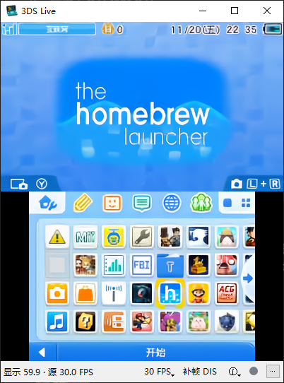
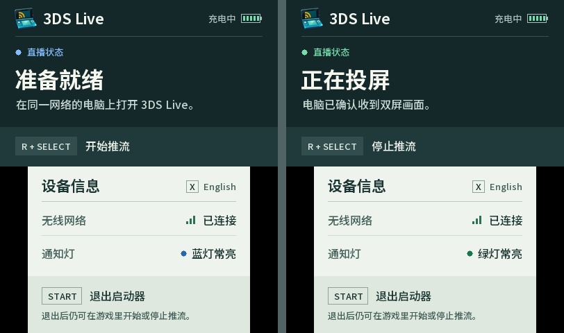

# 3DS Live 使用指南

3DS Live 将 New 3DS、New 3DS XL 或 New 2DS XL 的上下屏和游戏声音传到 Windows x64 电脑。掌机和电脑连接同一路由器，PC 可以用网线。默认端口为 UDP 8001。

## Windows 绿色版

将 ZIP 完整解压到自己选的普通文件夹，双击其中的 `Windows\3DS-Live.exe` 即可运行。播放器和 Qt 运行库一起随包提供。移动播放器时，将它旁边的 `runtime` 文件夹一起移动。

*图中掌机选中了 Homebrew Launcher。左下角的「源 30.0 FPS」是掌机画面的源帧率，「显示 59.9」是开启 DIS 补帧后的播放器显示帧率。*

## 掌机安装与升级

掌机启动器支持简体中文和英文。首次打开时跟随掌机系统语言，简体或繁体中文系统显示简体中文，其他语言显示英文。在启动器按 **X** 可切换语言并保存选择，也可以切回跟随系统。

The launcher supports English and Simplified Chinese. Chinese systems default to Simplified Chinese. All other systems default to English. Press **X** to switch languages. Your choice is saved across launches. Switching back to the system language restores automatic selection.

上屏显示直播状态、下一步操作和电池状态，下屏显示无线网络、通知灯和退出快捷键。发生启动错误时，下屏会列出可用的错误代码。

推流时按 **HOME** 切换界面，掌机会暂停采集约 0.75 秒，再自动恢复同一场直播。PC 播放器在弱网时会保持你选择的目标帧率。

可在 Windows 播放器的 **⋯ → 画质** 选择 **2× 实时超分 · SPAN**，在 **投屏设置 → 画面与补帧** 查看效果的兼容性。

掌机端只需选择下面一种文件，两种启动器均内置同一份直播模块。

- 要从 **Homebrew Launcher** 打开，将 `3ds-live.3dsx` 复制到 SD 卡的 `/3ds/3ds-live/3ds-live.3dsx`，然后选择 **3DS Live**。完整 ZIP 中的同一文件已放在 `SD/3ds/3ds-live/`。
- 要从 **HOME 菜单** 打开，用掌机上的 CIA 安装工具安装 `3ds-live.cia`，然后选择 **3DS Live**。完整 ZIP 将 CIA 放在顶层。

首次使用前，按住 **SELECT** 开机，在 Luma3DS 配置中勾选 **Enable loading external FIRMs and modules**，按 **START** 保存。如果从 Recorder 迁移且曾开启 **Launch On Startup**，先在旧控制程序中关闭它，再完整重启掌机。旧模块与独立版使用相同的直播快捷键。原来的 SD 录像可以保留。

第一次打开 **3DS Live** 时，启动器会将内置模块写入 SD 卡的 `/luma/sysmodules/0004013000F1D402.cxi`。已启用 Luma 外部模块且没有旧模块运行时，当次即可进入就绪画面。之后每次开机要投屏时，先打开一次启动器。

### 更新已安装的 3DS Live

- **掌机端**沿用原来的安装方式，替换 SD 卡上的 `3ds-live.3dsx` 或覆盖安装新版 CIA，然后打开 **3DS Live**。如果正在投屏，可在停流后再次打开启动器完成更新。若屏幕提示重启，请先保存游戏进度，重启掌机后再打开启动器。
- **电脑端**完整解压新包，双击其中的 `Windows/3DS-Live.exe`。

## 开始投屏

1. 双击解压目录里的 **Windows/3DS-Live.exe**。如果 Windows 弹出防火墙提示，允许它在当前专用网络上通信。
2. 在掌机的就绪画面按一次 **R + SELECT** 开始投屏，PC 会显示启动器画面。要玩游戏时，按 **START** 关闭启动器，再进入游戏。也可以等进入游戏后才开始投屏。直播中再按一次 **R + SELECT** 即可停止。播放器和掌机可以按任意顺序启动。

*看到左图的「准备就绪」时可按 **R + SELECT**。电脑确认收到双屏后，掌机才会显示右图的「正在投屏」。这两种状态在 Azahar 中模拟展示。*

## 掌机通知灯

观察掌机的彩色通知灯。待命时按 **START** 退出启动器，蓝灯熄灭，之后仍可在游戏里按 **R + SELECT** 开始推流。已经推流时按 **START**，绿灯会随推流继续亮。

| 灯效 | 当前状态 |
| --- | --- |
| 蓝色常亮 | 3DS Live 启动器已就绪，等待按 **R + SELECT**。 |
| 琥珀色缓慢呼吸 | 已请求推流，正在找 PC，或等待 PC 确认收齐新画面。连续约 4 秒没有新的收帧确认也会回到此状态。 |
| 绿色常亮 | PC 持续确认收到了新的完整画面。 |
| 熄灭 | 待命时退出了启动器、手动停止了推流、掌机已合盖，或后台模块已退出。若合盖前正在推流，开盖后会重新连接。 |
| 红色短闪两次 | 掌机后台模块尝试启动推流失败。可查看 SD 卡 `/3ds/3ds-live/status.txt` 的 `result`。 |

## 更换 Wi-Fi 或 IP

在 Qt 播放器的 **⋯ → 投屏设置 → 投屏连接** 中将 **掌机 IPv4** 留空，即可自动发现掌机。更换地址后两端会自行重连，已保存的画质、音量和码率设置仍然有效。默认四秒未收到有效回应，掌机会重新广播寻找播放器。

多台电脑同时打开时，掌机会连接先回应的一台。要换电脑，关闭当前播放器，让另一台继续监听。想固定某台掌机时，可在 Qt 设置里填写它的 IPv4。

双方等待连接时，PC 向掌机的 UDP 8002 发送邀请，掌机也会向 PC 的媒体端口发送发现请求。一直等待连接时，请确认已按热键，两端在同一 IPv4 广播域，媒体端口一致。检查 Windows 防火墙对当前播放器完整路径的入站规则，允许专用网络中本地子网访问 UDP 8001（自定义端口时改用所选端口）。同一路径的显式阻止规则也需排查。访客网络和 AP 隔离会影响发现。

掌机的 `/3ds/3ds-live/status.txt` 可区分待机（`idle`）、寻找播放器（`searching`）、已配对（`streaming`）和启动错误（`error`）。同目录的 `network-status.txt` 记录套接字、发现请求和回应的结果。

默认双屏 30 FPS、0.8 MB/s，开启立体声。0.8 MB/s 是整条推流的上限，启用声音时掌机会预留 0.1 MB/s 给音频。在工具栏 **FPS** 手动选择两屏共同的目标帧率。遇到持续丢包时，播放器会调低码率，掌机按所选帧率继续采集。每对 JPEG 能使用的字节会随码率减少。底栏 **ⓘ** 可查看实际收齐 FPS、当前码率和双屏 JPEG Q；链路丢帧时，实际收齐 FPS 可能低于目标。

PC 上可以直接调节画质与码率，按 **F12** 查看诊断，按 **Ctrl+R** 将直播保存为 MP4。其余画质、补帧和 RTSP 选项见随包的 `Windows/runtime/README.md`。

已有适配本机显卡的 TensorRT 加速包时，可将原来的 `Windows/runtime/acceleration` 整个目录复制到新播放器的相同位置。播放时可在性能卡上查看 FBCNN 和 RIFE 实际使用的后端。

需要自定义掌机端口或固定 PC 时，才将 `/3ds/3ds-live/live.ini.example` 复制为同目录的 `live.ini`。自动模式使用 `host=auto`，改端口时两端填相同的值。停止、重新开始直播后生效。
