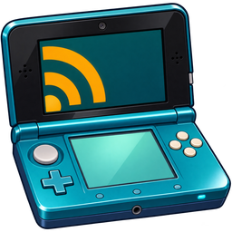
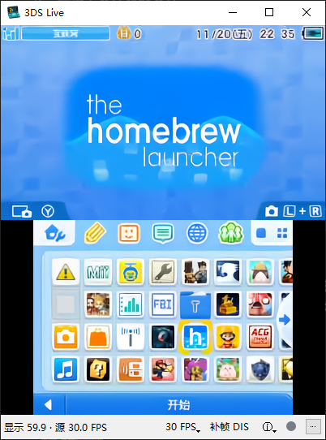
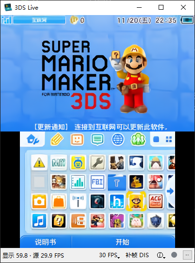
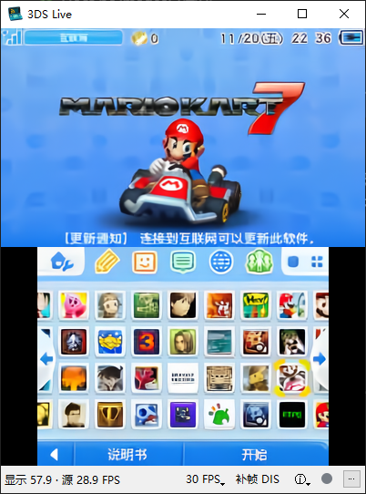
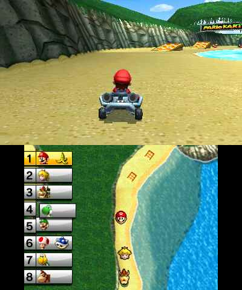
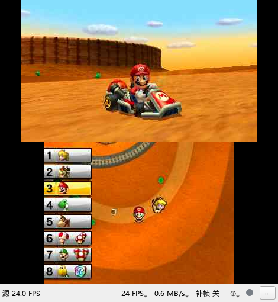

  

<h1 align="center">3DS Live</h1>

把 New Nintendo 3DS 的上下屏和游戏立体声，无线投到 Windows 电脑上。

<a href="INSTALL.md">安装与首次投屏</a> · <a href="live/qt/README.md">播放器操作</a>

  
  
  

在掌机 HOME 菜单中选中 Homebrew Launcher、《超级马力欧创作家》或《马力欧卡丁车 7》时，上屏会显示对应软件。这三张图直接截自接收真机推流的 Windows 播放器，点击可查看原图。

## 第一次投屏

需要已启用 Luma3DS 外部系统模块的 **New 3DS、New 3DS XL 或 New 2DS XL**，以及一台 **Windows x64** 电脑。掌机连 Wi-Fi，电脑可以用网线或 Wi-Fi 接入同一路由器。

1. **电脑上打开播放器。** 完整解压发布包，双击 `Windows/3DS-Live.exe`。
2. **掌机上打开 3DS Live。** 使用 Homebrew Launcher 时复制包内 `SD/3ds/` 下的程序；想从 HOME 菜单打开则安装 `3ds-live.cia`。两种方式都已内置直播模块。
3. **在「准备就绪」画面按 R + SELECT。** 两端会自动发现对方。看到「正在投屏」后，按 **START** 退出启动器即可进入游戏。再按一次 **R + SELECT** 停止投屏。

如何启用 Luma3DS 外部系统模块、更新程序、看懂通知灯或排查连接，见[图文使用指南](INSTALL.md)。

## 看双屏、调画质、保存片段

  
  

《马力欧卡丁车 7》比赛中，上屏看赛道，下屏看排名、道具和对手位置。左图是掌机传出的原尺寸双屏，右图是另一段真机比赛在播放器中的回放。

- **双屏与声音。** 可以同时看上屏动作和下屏地图，在电脑上听游戏立体声。掌机或电脑更换局域网 IP 后会重新连接。
- **画质与流畅度。** 工具栏可以调目标帧率和带宽。画质菜单提供 JPEG 去块和 2× 超分，可按显卡性能选择；需要补帧时可选光流或 RIFE。[播放器操作说明](live/qt/README.md)
- **录制与直播。** 按 **Ctrl+R** 可在电脑上保存 MP4。要将画面接入 OBS，可以通过现有 RTSP 服务输出。

## 致谢与许可 · Credits

感谢 **BolgarMaxym97** 开发 **3ds-recorder**。3DS Live 的掌机端沿用了上游的后台系统模块、双屏 DMA 采集和 DSP 立体声采集。**nicedayzhu** 在此基础上开发了双屏 Live 分支，并将其整理为本独立项目。[3ds-recorder 上游](https://github.com/BolgarMaxym97/3ds-recorder) · [Live 分支](https://github.com/nicedayzhu/3ds-recorder/tree/feature/dual-screen-live)

独立项目由 nicedayzhu 维护，采用 MIT 许可。掌机开发工具、JPEG 编码器、播放器依赖、字体和画质模型的作者与许可见完整致谢。[项目许可](LICENSE) · [完整致谢](docs/CREDITS.md) · [开发与构建](docs/DEVELOPMENT.md)
