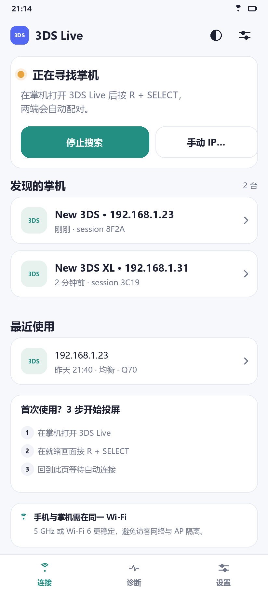
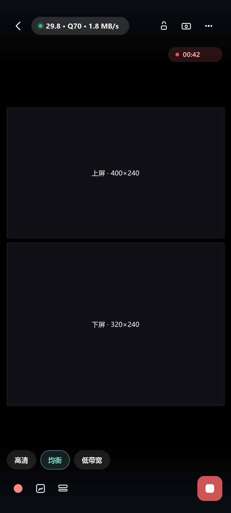
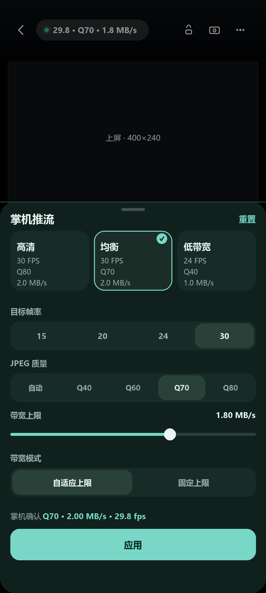
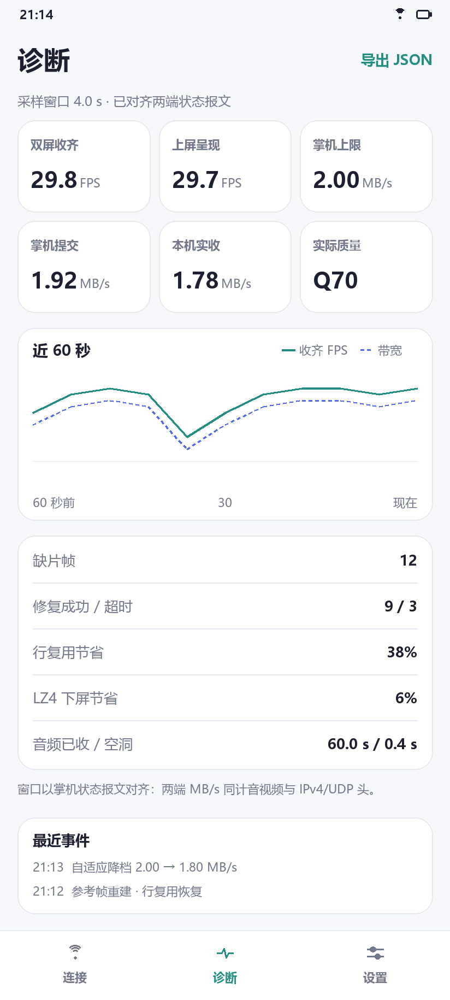

# 3DS Live Android — 界面设计规范

面向 Android 手机的 Flutter / Material 3 设计规范。视觉基线取自 [cia-bridge](https://github.com/nicedayzhu/cia-bridge) 的令牌层，信息密度与"平铺、无阴影、发丝线分层"的处理参考 [game-format-studio](https://github.com/nicedayzhu/game-format-studio) 的 `DESIGN-SPEC.md`；按触屏重新校准尺寸，不照搬桌面密度。

功能取舍与架构见 [DESIGN.md](DESIGN.md)。

## 1. 设计立场

- **冷静的工具感**：像一个完成的日常工具，不像调试器，也不像营销页。禁止渐变背景、玻璃拟态、霓虹描边、装饰性网格、Emoji 图标、巨型圆角。
- **画面优先**：直播页是唯一允许"暗场"的界面，所有控件为画面让路，3.5 s 自动淡出。
- **状态三重编码**：颜色 + 图标 + 文字同时表达（投流中不只靠绿点）。
- **单一强调色**：青绿 `#238E82` 只用于当前动作；蓝 `#5268F2` 只作品牌与次级标识；语义色只出现在结果与告警。
- **平铺分层**：零 elevation，靠 `surfaceContainer`、发丝线和 6–16% 强调色水洗分层。
- **两处主题**：设置/连接页跟随系统浅深色；直播页固定暗场，避免主题色影响观感。

## 2. 设计令牌

### 2.1 颜色

| 语义 | 浅色 | 深色 | 用法 |
| --- | --- | --- | --- |
| `canvas` | `#F7F8FC` | `#081411` | 页面底色 |
| `surface` | `#FFFFFF` | `#10211D` | 卡片 |
| `surfaceHigh` | `#F1F3F8` | `#172C27` | 输入框、内嵌块、次级按钮底 |
| `softSurface` | `#F3F5FA` | `#172C27` | 列表行悬浮/按下的底 |
| `ink` | `#1C2030` | `#EAF5F2` | 主文字 |
| `muted` | `#73798C` | `#9CB0AA` | 次文字、单位、说明 |
| `line` | `#E7E9F2` | `#29413A` | 发丝线、描边 |
| `primary` | `#238E82` | `#78D7C7` | 主按钮、选中态、强调数字 |
| `primarySoft` | `#E7F1ED` | `#1B2D27` | 选中底、预设卡高亮底 |
| `secondary` | `#5268F2` | `#9AA8FF` | 品牌标识、徽标、链接 |
| `success` | `#2CAF7A` | `#2CAF7A` | 投流中、完成 |
| `warning` | `#E19B39` | `#E19B39` | 搜索中、重连、建议 |
| `danger` | `#D65757` | `#FFB4AB` | 错误、停止 |
| `overlay` | — | `#0B0F14` 78% / 92% | 直播页控件底、状态条 |

**状态色与掌机通知灯同源**，让两端描述一致：

| 状态 | 色 | 文案 |
| --- | --- | --- |
| 就绪 / 待机 | `#3D7BF7` 蓝 | 掌机已就绪 |
| 搜索 / 重连 | `#E8A33D` 琥珀 | 正在寻找掌机 |
| 投流中 | `#35C07A` 绿 | 正在投流 |
| 错误 | `#E05A5A` 红 | 连接失败 |

容器色调统一由 `ColorScheme.fromSeed(seedColor: #48C9B0)` 派生，并显式覆盖 `primary/secondary/surface/onSurface/outline/error`，与 cia-bridge 完全一致，避免色板漂移。

### 2.2 字体

- 家族：`NotoSansSC`（随包，子集化），回退 `Roboto`、`sans-serif`；数字使用 `FontFeature.tabularFigures()`。
- 字阶（移动端校准，行高按 1.45–1.5）：

| 角色 | 字号/行高 | 字重 | 用途 |
| --- | --- | --- | --- |
| 页面标题 | 24 / 32 | w700 | 连接、诊断、设置 |
| 区块标题 | 17 / 24 | w700 | "发现的掌机"、"画面" |
| 卡片标题 | 15 / 22 | w600 | 预设名、设备名 |
| 正文 | 14 / 21 | w400 | 说明、值 |
| 元数据 | 12 / 18 | w400 | 单位、IP、时间 |
| 标签 | 11 / 16 | w600 | 徽标、状态胶囊 |
| 大数字 | 28 / 34 | w800 | 直播页 FPS |
| 中数字 | 20 / 26 | w700 | 诊断指标 |

不得使用 10 px 以下文字（game-format-studio 的桌面密度不适用）。

### 2.3 间距、圆角、描边

- 4 px 基线：4 / 8 / 12 / 16 / 20 / 24 / 32。
- 页面左右边距 **16**；直播页为 0（画面满幅）。
- 区块间距 24；卡片间距 12；卡片内边距 16；列表行高 56（≥48 触控目标）。
- 圆角：卡片 16、按钮 14、输入 12、底部弹层顶部 24、状态胶囊 99、缩略图 12。
- 描边 1 px `line`；不使用阴影。

### 2.4 动效

| 场景 | 时长 | 曲线 |
| --- | --- | --- |
| 页面切换 | 220 ms | `easeOutCubic` 淡入 + 8 px 位移 |
| 状态胶囊文字变化 | 180 ms | `AnimatedSwitcher` 淡入 |
| 控件显示/隐藏 | 200 ms | 透明度 + 12 px 位移 |
| 预设卡选中 | 160 ms | 底色 + 描边 |
| 搜索雷达 | 1.4 s 循环 | 两个同心圆，透明度 0.35→0；`disableAnimations` 时静止 |
| 诊断图刷新 | 1 s tick | 直接重绘，不做动画 |

系统开启"减少动画"时，所有位移与循环动画退化为一次性淡入。

### 2.5 图标与品牌

- 图标统一使用 Material Symbols Rounded（或等价 1.5–1.7 px 线宽的线性图标），24 dp 网格，常用尺寸 20 / 22 dp；不使用 Emoji、彩色贴纸或双色图标。
- 应用图标：`secondary` 蓝圆角方块（圆角约 26%）+ 白色 "3DS" 字标，与 PC 播放器图标同源；自适应图标前景留 25% 安全区。
- 启动页：纯 `canvas` 底 + 居中 64 dp 图标，不做动画、不放版本号；深色跟随系统。

## 3. 信息架构与导航

```
底部导航（竖屏）
├─ 连接      连接页（默认）
├─ 诊断      诊断页（无数据时显示占位）
└─ 设置      设置页
直播页为全屏路由，不显示底部导航；返回手势先退出直播页。
```

- 直播页 → "更多" 打开底部弹层：画质、布局、诊断、录制、关于。
- 设置页 → 关于为二级页面。
- 通知栏常驻（前台服务）：状态、FPS/带宽摘要、"停止"、"录制中"标记。

## 4. 页面规范

### 4.1 连接页



```
┌───────────────────────────────────────┐
│ ●  3DS Live               [主题] [⚙]  │  56 品牌栏，logo 28
│                                       │
│ ┌───────────────────────────────────┐ │
│ │  正在寻找掌机                     │ │  状态卡：色点 10 + 标题 17
│ │  在掌机打开 3DS Live 后按         │ │  正文 14 muted，最多两行
│ │  R + SELECT                       │ │
│ │  [ 停止搜索 ]      [ 手动 IP… ]   │ │  主按钮 48 / 次按钮 44
│ └───────────────────────────────────┘ │
│                                       │
│ 发现的掌机                    3 台    │  区块标题 + 右侧计数
│ ┌───────────────────────────────────┐ │
│ │ ▣  New 3DS · 192.168.1.23         │ │  设备卡：图标 40 圆角 12
│ │    刚刚 · session 8F2A        ▸   │ │  元数据 12；右侧 chevron
│ └───────────────────────────────────┘ │
│                                       │
│ 最近使用                              │
│ ┌───────────────────────────────────┐ │
│ │ ▣  192.168.1.23 · 昨天 21:40     │ │  点击直接重连
│ └───────────────────────────────────┘ │
│                                       │
│ 首次使用？ 3 步开始投屏            ?  │  可折叠引导
│  1 打开掌机 3DS Live  2 按 R+SELECT   │
│  3 回到此页等待连接                   │
└───────────────────────────────────────┘
```

| 元素 | 规格 |
| --- | --- |
| 品牌栏 | 高 56，左 logo 28×28（圆角 8，蓝底白字），标题 17/w700，右两个 40 图标按钮（主题切换、设置） |
| 状态卡 | `surface`，圆角 16，内边距 16；状态点 10×10 带 3 px 同色 18% 外环；主按钮 `FilledButton` 全宽 48；次按钮 `OutlinedButton` |
| 设备卡 | 高 ≥72，行内：图标块 40（`primarySoft` 底、圆角 12）+ 标题 15/w600 + 元数据 12/muted + `chevron_right`；按下 `softSurface` |
| 空态 | "还没有发现掌机" + 12 行说明 + "重试" 文本按钮；图上用 48 线框图标，不用插画 |
| 引导 | `AnimatedCrossFade` 展开；编号圆点 20，正文 12；"?" 图标打开底部弹层详述 |
| 网络提示 | `surface` 卡，Wi-Fi 图标 + 12/11 两行；检测到非 Wi-Fi 或访客网络时改为琥珀色描边 |

**文案**（错误态必须可执行）：

| 场景 | 标题 | 说明 |
| --- | --- | --- |
| 搜索中 | 正在寻找掌机 | 在掌机打开 3DS Live 后按 **R + SELECT** |
| 已连接 | 已连接 192.168.1.23 | 掌机确认后自动进入直播页 |
| 超时 | 没有找到掌机 | 检查两端是否在同一 Wi-Fi，或手动填写掌机 IPv4 |
| 端口占用 | 端口 8001 被占用 | 更换监听端口后重试 |
| 权限/后台 | 后台被系统限制 | 允许 3DS Live 后台运行，否则切出会断开 |

### 4.2 直播页



双屏是 5:3 与 4:3 的横向画面，上下叠起来接近 5:6，因此**竖屏是默认形态**：手机横过来反而会把两块屏压小。横屏留给"单屏放大"与"并排"两种可选布局。

竖屏（默认）：

```
┌─────────────────────────────┐
│ ◂   ● 29.8 · Q70 · 1.8 MB/s │ 高 56，暗场 ← 状态胶囊
│                             │
│  ┌───────────────────────┐  │
│  │      上屏 400×240     │  │ 宽 396，等比，距顶 12
│  └───────────────────────┘  │
│  ┌───────────────────────┐  │ 间距 8
│  │      下屏 320×240     │  │
│  └───────────────────────┘  │
│                             │
│ [高清][均衡][低带宽] ⏺ ⤓ ⋯ ■│ 高 64，暗场
└─────────────────────────────┘
```

横屏（可选布局，设置 → 画面布局）：

```
单屏（默认横屏）                          并排
┌───────────────────────────┐      ┌───────────────────────────┐
│ ◂  ● 29.8 · Q70          │      │ ◂  ● 29.8 · Q70          │
│ ┌───────────────────────┐ │      │ ┌─────────┐ ┌─────────┐   │
│ │                       │ │      │ │  上屏   │ │  下屏   │   │
│ │     上屏 或 下屏       │ │      │ │ 400×240 │ │ 320×240 │   │
│ │                       │ │      │ └─────────┘ └─────────┘   │
│ └───────────────────────┘ │      │ [高清][均衡]  ⏺ ⤓ ⋯  ■    │
│ [高清][均衡]  ⏺ ⤓ ⋯  ■    │      └───────────────────────────┘
└───────────────────────────┘
```

| 元素 | 规格 |
| --- | --- |
| 画布 | 纯 `#000` 底；等比、不拉伸；双屏间距 8；可捏合缩放 1×–3×，双击在"适应 / 2×"间切换 |
| 顶部条 | 高 56，`overlay` 78% → 透明；左侧返回 + 状态胶囊；右侧锁定、截图、更多 |
| 状态胶囊 | 圆角 99，`white@14%` 底；6 px 绿点 + "29.8 · Q70 · 1.8 MB/s"，数字 tabular；点击进入诊断页 |
| 底部条 | 高 64，`overlay` 92%；3 个预设 chip（选中 = 青绿描边 + 8% 底）+ 录制 / 截图 / 布局 / 停止 |
| 自动隐藏 | 3.5 s 无操作淡出；单击画面恢复；长按 500 ms 锁定常显；锁定瞬间显示小锁 1.5 s |
| 停止 | `danger` 实心 44 高；二次确认（录制中提示"将结束录制"） |
| 横屏 | 单屏布局左右滑动切换上/下屏；并排布局两块屏等高（各占约 4:3 / 5:3 宽度），适合平板上同时看 |
| 保持常亮 | 默认开；`WAKE_LOCK` 仅在此项开启时持有 |

**手势**：捏合缩放 · 放大后双指平移 · 双击切换缩放 · 单击显示控件 · 下滑收起控件 · 横屏单屏布局下左右滑动切屏 · 返回键先退出缩放/横屏，再退出直播页。

### 4.3 画质弹层



```
┌───────────────────────────────────────┐
│            ▂▂▂▂ (drag handle)         │
│ 掌机推流                     [重置]   │
│ ┌─────────┐ ┌─────────┐ ┌─────────┐   │
│ │ 高清    │ │ 均衡 ✓  │ │ 低带宽  │   │  3 张预设卡，宽 1/3
│ │ 30 FPS  │ │ 30 FPS  │ │ 24 FPS  │   │
│ │ Q80     │ │ Q70     │ │ Q40     │   │
│ │ 2.0 MB/s│ │ 2.0 MB/s│ │ 1.0 MB/s│   │
│ └─────────┘ └─────────┘ └─────────┘   │
│                                       │
│ 自定义                                │
│ 目标帧率   [15] [20] [24] [30]        │  SegmentedButton
│ JPEG 质量  [自动] [Q40] [Q60] [Q70] [Q80] │
│ 带宽上限   ──●──────────  1.80 MB/s   │  滑块 + 当前值
│ 带宽模式   [自适应上限] [固定上限]     │
│                                       │
│ 掌机确认：Q70 · 2.00 MB/s · 29.8 fps  │  实时反馈，12/muted
│ [            应用            ]        │
└───────────────────────────────────────┘
```

| 元素 | 规格 |
| --- | --- |
| 弹层 | `showModalBottomSheet(isScrollControlled)`，顶部圆角 24，最大高度 88%，`SafeArea` |
| 预设卡 | 高 92；标题 15/w700、三行指标 12；选中：`primarySoft` 底 + 1.5 px `primary` 描边 + 右上 16 对勾；未选 `surfaceHigh` |
| 分段控件 | 高 44，圆角 14；选项 12–13 字；不可用档位置灰并带 12 px 说明（如"需掌机 0.1.7+"） |
| 滑块 | 轨道 4，活性段 `primary`；档位为 400 k–2 M 的 14 档，取整到 0.05 MB/s 显示 |
| 应用 | 全宽 48；点击后按钮进入 200 ms loading，掌机确认后弹层内显示"已应用"，1.2 s 后不关闭，允许继续调 |
| 反馈 | 掌机回的 `R16S` 值优先于本地请求值展示；未确认时显示"待确认"琥珀标签 |

### 4.4 诊断页



```
┌───────────────────────────────────────┐
│ 诊断                       [导出 JSON] │
│ 采样窗口 4.0 s · 已对齐两端状态        │
│ ┌───────────┬───────────┬───────────┐ │
│ │ 双屏收齐  │ 上屏呈现  │ 掌机上限  │ │
│ │ 29.8 FPS  │ 29.7 FPS  │ 2.00 MB/s │ │
│ ├───────────┼───────────┼───────────┤ │
│ │ 掌机提交  │ PC 实收   │ 实际 Q    │ │
│ │ 1.92 MB/s │ 1.78 MB/s │ Q70       │ │
│ └───────────┴───────────┴───────────┘ │
│                                       │
│ 近 60 秒                              │
│  ┌─────────────────────────────────┐  │
│  │      ╱╲    ╱╲╱╲                 │  │  收齐 FPS 折线
│  │  ╱╲╱  ╲__╱     ╲___             │  │  带宽虚线叠加
│  └─────────────────────────────────┘  │
│                                       │
│ 丢片与恢复                            │
│  缺片帧 12 · 修复成功 9 · 超时 3      │
│  行复用节省 38% · LZ4 节省 6%         │
│ 音频  已收 60.0 s · 空洞 0.4 s        │
│                                       │
│ 说明：窗口以掌机状态报文对齐…         │  12/muted
└───────────────────────────────────────┘
```

- 指标瓦片 3 列网格，高 84，`surface` 圆角 16，数字 20/w700 + 单位 11/muted；点击瓦片显示该指标口径说明（`Tooltip` 不适用于触屏，用底部弹层）。
- 折线图用 `CustomPainter`：线宽 2、`primary`；带宽用 1.5 虚线 `secondary`；无网格，仅 0/最大值两条淡线。
- 无数据时整页替换为空态："开始投流后这里会显示诊断"。
- "导出 JSON" 生成与 PC `--stats` 同字段的快照文件，走系统分享。
- 曲线下方保留「最近事件」卡：只记会改变观感的事件（自适应降档、参考帧重建、修复超时、录制开始），最多 3 条，超出折叠。

### 4.5 设置页

分组列表，行高 56，组标题 12/w600 uppercase 风格（中文不加字距）：

| 分组 | 行 | 控件 |
| --- | --- | --- |
| 网络 | 监听端口 | 值 + 数字输入弹层（默认 8001） |
| | 自动发现 | 开关 |
| | 掌机 IPv4 | 值/留空 = 自动，输入弹层 |
| | 网络提示 | 说明行，12/muted，检测到非 Wi-Fi 时显示琥珀 |
| 显示 | 画面布局 | 上下 / 并排 / 仅上屏 / 仅下屏 |
| | 播放缓冲 | 60 / 100 / 160 ms 分段 |
| | 保持屏幕常亮 | 开关（默认开） |
| | 隐藏状态栏 | 开关（默认开） |
| 音频 | 输出音量 | 滑块 |
| | 静音 | 开关 |
| 录制 | 分辨率 | 720p / 1080p |
| | 视频码率 | 4 / 8 / 12 Mbps |
| | 保存位置 | 值 + 打开相册 |
| 高级 | 报文节奏对比（R21） | 开关，附"仅诊断"说明 |
| | 导出诊断 / 查看日志 | 行 |
| 关于 | 版本、许可、致谢、项目主页 | 二级页 |

危险动作（清除最近设备）放组尾，`danger` 文字按钮 + 确认弹层。

### 4.6 直播中的通知

```
● 3DS Live 正在投流
  29.8 FPS · Q70 · 1.8 MB/s · 已录制 02:14
  [停止投流]   [停止录制]
```

前台服务通知：`IMPORTANCE_LOW`，常驻，不可滑动清除；停止操作走 `PendingIntent` 回到服务。录制时增加一行与"停止录制"动作。

## 5. 组件清单

| 组件 | 规格 | 复用自 |
| --- | --- | --- |
| `BrandBar` | 高 56，logo 28 + 标题 17/w700 + 右侧 40 图标 | cia-bridge `_TopBar` |
| `StatusCard` | 圆角 16，状态点 + 标题 + 两行说明 + 按钮组 | cia-bridge `_DiscoveryBar` + `_FlowProgress` 的组合 |
| `DeviceCard` | 高 ≥72，图标块 40，标题/元数据，chevron | cia-bridge 列表行 |
| `StatusPill` | 圆角 99，6 px 点 + 12/w600 文本，`white@14%`（暗场） | 新增 |
| `PresetCard` | 92 高，3 行指标，选中描边 + 对勾 | 新增（画质） |
| `MetricTile` | 84 高，数字 20/w700 + 单位 11 | cia-bridge `_TransferMetric` |
| `SettingsRow` | 56 高，标题 14 + 值 13/muted + chevron/开关 | cia-bridge 设置抽屉 |
| `SectionHeader` | 17/w700 + 可选右侧计数/动作 | cia-bridge `_SectionHeading` |
| `EmptyState` | 48 线框图标 + 标题 15 + 说明 12 + 文本按钮 | cia-bridge `_DeviceEmptyState` |
| `NoticeBanner` | 2 px 左描边（语义色）+ 6.5% 同色底 + 图标 18 + 正文 12 | game-format-studio `_InlineNotice` |
| `LiveBar` | 高 64，暗场 92%，chip 组 + 图标按钮 | 新增 |
| `Sparkline` | 高 80，双线（FPS 实线 / 带宽虚线），仅 0/最大值两条淡线 | 新增 |

## 6. 响应式

| 宽度 | 适配 |
| --- | --- |
| < 600 dp | 单列；卡片全宽；直播页竖屏上下双屏 |
| 600–899 dp（折叠屏展开/小平板） | 连接页两列（状态卡 + 设备列表）；直播页可并排双屏 |
| ≥ 900 dp（平板横屏） | 连接页左侧导航固定的两栏；诊断页指标 4 列；直播页并排双屏 + 右侧浮层控件 |

横竖屏切换不重建引擎：布局只改变合成参数与控件位置，播放继续。

## 7. 无障碍与本地化

- 触控目标 ≥48 dp；文本与底对比 ≥4.5:1（暗场控件加 78% 遮罩后用白字）。
- 所有状态点同时有文本；图标按钮带 `Semantics(label:)`；FPS/带宽朗读为"每秒 29.8 帧，质量 70，每秒 1.8 兆字节"。
- 支持系统字号放大到 1.3×；诊断网格在 1.3× 下改为 2 列而非截断。
- 中英文：中文为默认；英文文案按仓库习惯使用 `3DS`, `FPS`, `MB/s`, `Q70` 等缩写。文案 key 集中在 `lib/l10n`，不散落硬编码。
- 动效遵循系统"移除动画"设置。

## 8. Flutter 落地

- 主题：单文件 `theme/app_theme.dart`，直接沿用 cia-bridge 的 `ColorScheme.fromSeed` 构造与组件主题（Card 16 / 按钮 14 / 输入 12 / 弹层 20），仅把页面内边距改为 16、行高改为 56。
- 状态管理：`ChangeNotifier` + `ValueListenableBuilder`（与 cia-bridge 一致的轻量方案），不引入重型框架；引擎事件通过 `EventChannel` 流式写入 controller。
- 弹层：`showModalBottomSheet(useSafeArea: true, isScrollControlled: true, backgroundColor: surface, shape: RoundedRectangleBorder(borderRadius: BorderRadius.vertical(top: Radius.circular(24))))`。
- 直播页：`Scaffold(backgroundColor: Colors.black, extendBodyBehindAppBar: true)` + `Texture(textureId:)` 填满 + `Stack` 叠加控件；控件用 `AnimatedOpacity`/`AnimatedSlide`。
- 图表：`CustomPainter`，不做第三方依赖。
- 字体：随包 Noto Sans SC 子集（仅常用 3500 字 + 拉丁），体积目标 < 3 MB；数字用 `fontFeatures: [FontFeature.tabularFigures()]`。
- 黄金测试：视口 412×915（竖屏）、915×412（横屏）、673×841（折叠屏），浅/深各一套；沿用 cia-bridge 的 `precisionTolerance: 0.002` 与手动 `FontLoader`。

## 9. 与 PC 菜单的映射

| PC（Qt） | Android |
| --- | --- |
| ⋯ → 掌机推流（三档预设 / 自定义参数） | 直播页画质弹层（预设卡 + 自定义） |
| 底栏 FPS / Q / 带宽 快捷项 | 画质弹层内的分段与滑块（移动端不放底栏） |
| ⋯ → PC 画质增强 | 不做（仅保留"原始"与可选轻度锐化） |
| ⋯ → 运动补帧 | 不做 |
| ⋯ → 连接与输出… | 设置 → 网络 / 显示 / 音频 |
| F12 诊断 | 诊断页（指标瓦片 + 60 s 折线 + 导出） |
| Ctrl+R 录制 | 直播页 ⏺ 与通知动作 |
| 截图（PC 无） | 直播页 ⤓ |
| RTSP 发布 | 不做 |

## 10. 验收清单

- [ ] 连接页四态（搜索/已连接/超时/错误）文案与按钮均可用，空态不出现死路。
- [ ] 直播页横竖屏均无溢出；控件 3.5 s 自动隐藏；锁定后不隐藏。
- [ ] 画质弹层本地值、待确认、掌机确认三态可辨；不可用档位有说明。
- [ ] 诊断页无数据时为空态；有数据时窗口秒数与两端计数可对齐。
- [ ] 深色模式全部页面无"白闪"；直播页不受主题影响。
- [ ] 系统字号 1.3× 无截断；TalkBack 可完整朗读状态与指标。
- [ ] 断网/掌机停流/切后台三种中断均有明确提示与恢复路径。
