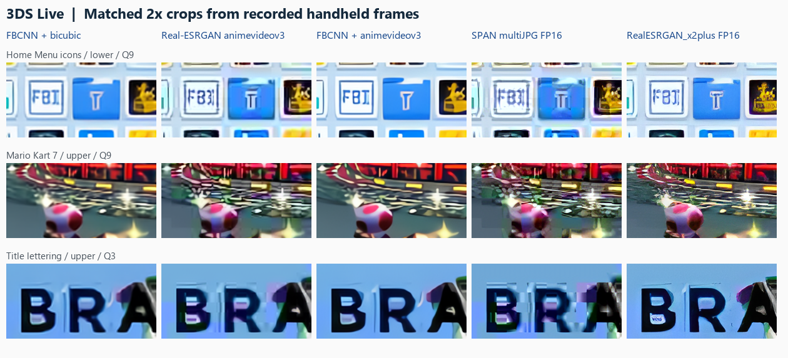

# 3DS Live 双屏 2× 超分评估

1.2.8 增加可选的 **2× 实时超分 · SPAN**，使用 Philip Hofmann 的 NomosUni multiJPG 权重。它能让这台测试机上更多运动画面在显示期限前完成 2× 放大。强压缩下，现有 FBCNN 和 Real-ESRGAN 档仍有保留价值。掌机编码、默认画质和已保存的模式沿用原设置。

## 为什么比较这些模型

官方 SPAN 的标准超分实验主要以双三次降采样生成输入。NomosUni multiJPG 使用同一类架构，训练时加入了多种缩放和 JPEG 压缩。FBCNN 学习的是原生分辨率 JPEG 修复。测试把三者分别用在各自的任务上。[SPAN 论文](https://openaccess.thecvf.com/content/CVPR2024W/NTIRE/papers/Wan_Swift_Parameter-free_Attention_Network_for_Efficient_Super-Resolution_CVPRW_2024_paper.pdf) · [NomosUni 作者模型卡](https://huggingface.co/Phips/2xNomosUni_span_multijpg) · [FBCNN 论文](https://openaccess.thecvf.com/content/ICCV2021/papers/Jiang_Towards_Flexible_Blind_JPEG_Artifacts_Removal_ICCV_2021_paper.pdf)

播放器原有的 `sr` 是 Real-ESRGAN 的 **AnimeVideo-v3**。核对了 ONNX 的全部 53 组参数，与作者权重转换为 FP16 后一致。播放器先用 SRVGGNetCompact 做 4× 推理，再缩到 2×，按 65% 模型结果、35% Lanczos 混合。本次也单独测试了官方 **RealESRGAN_x2plus**，它使用 23 个 RRDB 块，直接输出 2×。这两个版本的耗时和输出差异很大。[Real-ESRGAN 官方模型配置](https://github.com/xinntao/Real-ESRGAN/blob/master/inference_realesrgan.py#L67-L80)

## 画质与双屏耗时

在同一台 RTX 2060 SUPER 上使用 Windows x64、ONNX Runtime 1.22.1 和 DirectML。每次依次处理一个 400×240 上屏和一个 320×240 下屏，包含播放器的输入转换、输出读回和该模式的后处理。双屏同时变化、输入每秒 30 对时，每对的时间预算约为 **33.3 ms**。常规模型预热 7 对、测量 40 对，较重的 x2plus 预热 3 对、测量 6 对；后者的 P95 仅供量级参考。双三次使用 CPU。

质量测试选取 11 张有参考图的游戏画面，其中 5 张为无损模拟器截图，6 张取自《生化危机：启示录》的历史游戏视频，视频自带的压缩也会影响参考。先将参考图缩至一半，再填充到真实屏幕大小。有损组经过项目实际 JPEG 编码器和解码器。Q8 与 Q25 是该编码器的设置。对恢复的有效图像区域裁去 4 像素边缘，每张计算亮度 PSNR / SSIM，再取平均。两项越高表示越接近该参考，真实游戏没有同步的 2× 无压缩参考。另取四组历史掌机上下屏专做视觉对照。

| 模式 | 双屏中位数 / P95（ms） | 无 JPEG 的 PSNR / SSIM | Q25 的 PSNR / SSIM | Q8 的 PSNR / SSIM |
| --- | ---: | ---: | ---: | ---: |
| 双三次 2× | 1.6 / 1.8 | 25.23 / .824 | 23.48 / .703 | 21.88 / .606 |
| 官方 SPAN x2 ch48，FP32 | 38.3 / 42.7 | **28.43 / .906** | 23.23 / .698 | 21.49 / .592 |
| **NomosUni SPAN multiJPG，FP16** | **22.0 / 25.5** | 25.49 / .844 | 23.25 / .733 | 21.79 / .625 |
| 同一 NomosUni 权重，FP32 | 37.9 / 41.5 | 25.49 / .843 | 23.25 / .733 | 21.79 / .625 |
| 现有 Real-ESRGAN AnimeVideo-v3 | 43.2 / 47.6 | 25.76 / .845 | 23.84 / .751 | 22.06 / .651 |
| 官方 RealESRGAN_x2plus，FP16 | 147.5 / 149.8 | 24.45 / .787 | 23.00 / .721 | 21.49 / .628 |
| 同一 x2plus 权重，FP32 | 219.2 / 219.5 | 24.45 / .787 | 23.00 / .721 | 21.49 / .629 |
| FBCNN 去块后双三次 2× | 42.5 / 43.4 | 25.13 / .821 | 23.83 / .749 | 22.44 / .670 |
| FBCNN 去块后 AnimeVideo-v3 2× | 89.7 / 97.9 | 25.51 / .837 | **24.11 / .774** | **22.49 / .690** |

用同一组 41 张输入对照 Nomos 的两种精度，FP16 与 FP32 输出间的 RGB 通道平均绝对差为 0.076 个灰阶，单个通道最大差为 2 个灰阶（8 位输出）。这台显卡上 FP16 同时缩短了双屏处理时间。

在低码率标题画面里，x2plus 清除了较多色块，也改变了一些细笔画。FBCNN 配合现有 Real-ESRGAN 对图标和字幕边缘的修复比较稳定。Nomos 保留了更多压缩痕迹，优势主要在运动画面的实时覆盖。下面每一行都来自同一张真机压缩帧，按相同位置、相同倍率裁切。[逐屏测量 CSV](sr-panel-scores.csv)

## 实际播放器的显示期限

将同一段历史真机 UDP 数据按原到达时间回放到回环地址。使用 Qt 播放器的离屏窗口，固定双屏 2×、30 FPS 上限、0.8 MB/s、100 ms 播放缓冲，关闭补帧。对齐中间 12 秒的上屏采样，将每次更新的选帧编号与 Qt 完成绘制的 `paint` 事件配对，读取实际画质。推理赶不上时播放器仍可按时绘制原始画面，因此单看窗口帧率会高估超分覆盖。这里测量到 Qt 画布，物理显示器的扫描输出不在测量范围内。回放数据 SHA-256 为 `188e7e691d9f1754600aa8f34e0a37205a29fddd165a85a56a3cdda38bef1184`。

首轮各模式均选中了 **321** 次真实上屏更新。现有 AnimeVideo-v3 有 **47** 次按时用到增强图，官方 SPAN FP32 有 **111** 次，Nomos multiJPG FP16 有 **305** 次。标准 x2plus 的 FP16 与 FP32 均为 **0** 次，321 次选帧均使用原始图。交换 Nomos 和 AnimeVideo-v3 的测试顺序后，分别得到 **305/321** 和 **46/321**。两者都出现了 5 次超过 100 ms 的上屏间隔。其他 GPU、缓冲长度和上下屏同时变化的频率都会影响结果。

最后从 1.2.8 正式 ZIP 解压程序，再用同一段录像复测。两个模式各完成 321 次上屏绘制，每次都能和选帧记录一一对应。SPAN 使用 DirectML FP16，**306 次（95.3%）**绘制了增强图，另外 15 次绘制原图。AnimeVideo-v3 有 **50 次（15.6%）**绘制了增强图，另外 271 次绘制原图。两者仍各有 5 次超过 100 ms 的上屏间隔。

## 发布选择

- 看运动画面且想用 2× 时，可选 **2× 实时超分 · SPAN**。播放器先试 FP16，遇到不支持的驱动或模型运行失败再试同权重 FP32。两条路径都失败时使用播放器的效果回退。
- 需要尽可能消除 JPEG 色块、看清小字号时，保留 **FBCNN 高画质** 和 **FBCNN + Real-ESRGAN**。后者的单帧参考得分最高，也需要更多处理时间。
- 标准 **RealESRGAN_x2plus** 在这台 PC 上的 FP16 中位耗时已经超过四个源帧周期，未加入实时菜单。未在 Intel/AMD 实机上重复上述性能测量。
